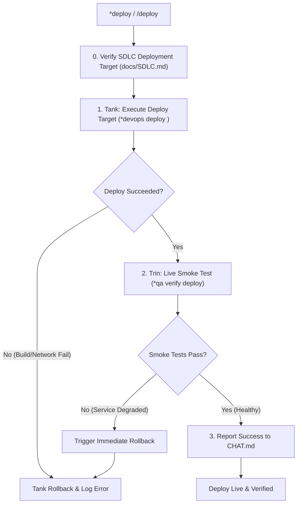

Deployment and release work-loop: executes predictable builds, deploys to target environments, and runs post-deploy smoke tests.

TLDR:
    Literature: Jez Humble & David Farley (*Continuous Delivery*).
    Invariant: Deployment as Code. All release operations must be automated via Makefile targets documented in docs/SDLC.md. Never perform uncaptured shell deploys. Always execute live post-deploy smoke tests.
    Chain: Tank (builds & deploys via bobp make) → Trin (executes live smoke test) → Bloop (reports status or triggers rollback).

# Deployment & Release Work-Loop (`deploy`)

## Overview

The `deploy` work-loop transitions tested software from the development workspace to a target staging, preview, or production environment. Grounded in Humble & Farley’s Continuous Delivery principles, it ensures releases are automated, repeatable, auditable, and verified with live smoke tests.

---

## Literature Grounding: Jez Humble & David Farley (*Continuous Delivery*)

> *"The deployment pipeline is, in effect, an automated implementation of your application’s build, deploy, test, and release process... Every change that passes the commit tests should be automatically deployable to testing environments, and deployments must be idempotent, versioned, and verified by automated smoke tests."*  
> — Jez Humble & David Farley, *Continuous Delivery*

In this work-loop:
1. **Source of Truth**: All deploy steps are defined in [docs/SDLC.md](file:///home/drusifer/Projects/bob_protocol/docs/SDLC.md) and backed by project Makefile targets (e.g. `bobp make deploy ENV=staging`). No one-off manual shell commands.
2. **Precondition**: The work must have passed all preceding unit, integration, and UAT gates.
3. **Automated Smoke Test**: Deployment is not complete when the build finishes uploading; it is complete only when Trin verifies live operational health (health checks, login, critical endpoints).

---

## The `deploy` Lifecycle



---

## Step-by-Step Procedure

### Step 0: Pre-Flight Check & SDLC Alignment
- Confirm `docs/SDLC.md` defines the deployment procedure and target environment `<env>`.
- Verify the git working tree is clean and all commits are tagged or pushed to the release branch as specified by the SDLC.

### Step 1: Tank — Automated Deployment (`*devops deploy <env>`)
- Execute the designated makefile deployment target:
  ```bash
  bobp make deploy ARGS="ENV=<env>"
  ```
- Monitor build logs, container initialization, and DNS/SSL provisioning.
- **If build or deployment fails**: Tank immediately captures logs to `build/build.out`, halts the loop, and notifies the team.
- **Handoff on Upload Success:**
  ```bash
  bobp chat "Artifacts deployed to <env>; instances online. @Trin *qa verify deploy <env>" --persona Tank --cmd "devops handoff" --to Trin
  ```

### Step 2: Trin — Post-Deploy Smoke Verification (`*qa verify deploy <env>`)
- Query live health endpoints (e.g. `/healthz`, `/status`, or CLI `--version`).
- Run a targeted smoke test suite verifying critical user paths in the live environment.
- Confirm database migrations applied cleanly without schema mismatches.
- **Handoff on Pass:**
  ```bash
  bobp chat "Live smoke tests 100% green on <env>. System healthy." --persona Trin --cmd "qa handoff" --to all
  ```

### Step 3: Loop Conclusion
- Post official deployment record to `agents/CHAT.md`.
- Mark the deployment task complete in `task.md`.

---

## Rollback Protocol

If Trin’s smoke test fails:
1. Tank executes immediate rollback via `bobp make rollback ARGS="ENV=<env>"`.
2. Post failure incident report to `agents/CHAT.md`.
3. Halt deployment loop until the defect is diagnosed via a `*fix` loop.

---

## Loop Effectiveness Rubric (`LOOP_DEPLOY`)

Reviewed by Tank (at Step 3 Conclusion) or Trin (at Smoke Verification) or during `*judge deploy`.  
Verdict line in `agents/CHAT.md`: `rubric LOOP_DEPLOY: ASCODE=L PREFLT=L SMOKE=L ROLLBK=L AUDIT=L`

| Code | Criterion | Weak (W) | Acceptable (A) | Strong (S) |
|---|---|---|---|---|
| `ASCODE` | **Pipeline as Code** | Ad-hoc, uncaptured shell commands run manually; hardcoded credentials in terminal; bypassed Makefile targets. | Deployment driven entirely via `bobp make deploy ARGS="..."` per specifications in `docs/SDLC.md`. | Idempotent, deterministic deployment target; build artifact versioned and hashed; logs captured cleanly in `build/build.out`. |
| `PREFLT` | **Pre-Flight Hygiene** | Deployed uncommitted local changes, untracked files, or unverified test states to target environment. | Git working tree verified clean; all commits pushed/tagged per SDLC; test suite confirmed green prior to deploy. | Automated pre-flight checks validated environmental configs, dependency hashes, secrets availability, and DB migration readiness. |
| `SMOKE` | **Smoke Verification** | Deployment assumed successful once upload exited 0 without live traffic or endpoint verification. | Trin executed post-deploy smoke tests against live target environment (health endpoints, core workflows, database connectivity). | Comprehensive smoke sweep covering authentication, primary API contracts, database migrations, and telemetry/logging confirmation. |
| `ROLLBK` | **Rollback Safety** | No rollback target defined; failed deployment left target environment in broken, unrecoverable state. | Rollback target documented (`bobp make rollback`) and triggered immediately if smoke tests or health checks failed. | Zero-downtime blue/green or canary strategy; automated instant rollback with health degradation alerting and state preservation. |
| `AUDIT` | **Audit Trail & Logging** | Deployed silently without posting to CHAT.md; version tag omitted; failed to update task board. | Deployment status, target environment, version/commit hash, and smoke results posted to `agents/CHAT.md`. | Complete release audit trail: changelog updated, git tags pushed, deployment artifact archived, and stakeholder notification posted. |
