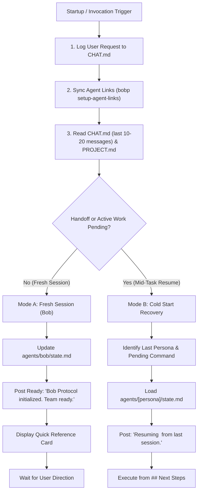

Formalizes the initialization and session resume procedure across all supported AI harnesses.

TLDR:
    Invoked via `*init`, `/init`, `/bob-protocol init`, `*startup`, or `*resume`.
    Fresh session: verify agent links (`bobp setup-agent-links`), read CHAT.md & PROJECT.md, post ready status as Bob, display quick reference, wait for user direction.
    Cold start recovery: locate last active handoff in CHAT.md (prepared via `prep-clear`), load persona state.md, post resume message, resume from `## Next Steps`.
    Hard rule: Rapid Startup — NEVER run full test suites on init. Never auto-execute tasks without user direction.

# Bob Protocol — Initialization & Startup Skill (`init`)

## Overview

The `init` skill governs the entry lifecycle for any AI agent entering a BobProtocol workspace. It guarantees that working memory, discovery symlinks, team chat context, and project capability declarations are reconciled consistently regardless of the host environment (Google Antigravity, Gemini CLI, Claude Code, OpenAI Codex, Cursor, GitHub Copilot).

---

## Triggers & Invocations

| Trigger / Command | Context | Primary Handler |
| :--- | :--- | :--- |
| `/init`, `*init`, `/bob-protocol init` | Explicit session startup command | **Bob** (`*prompt`) |
| `*startup`, `*chat init` | Natural or chat-directed start | **Bob** (`*prompt`) |
| `*resume` | Explicit context-clear or session restart | Last active persona |
| `@<Persona>`, `/<persona>`, `$<persona>` | Direct harness persona invocation | Target persona |

---

## The Initialization Lifecycle



---

## Step-by-Step Procedure

### 1. Log Request (ALWAYS FIRST)
Any explicit slash command or invocation message must immediately be recorded to `agents/CHAT.md`:
```bash
bobp chat "<user request>" --persona User --cmd request
```
*Note for Direct Invocations*: If entered via harness-specific syntax (e.g., `@neo`, `/trin`, `$bob`), immediately log entry:
```bash
bobp chat "Activating persona <Name> via harness invocation." --persona <Name> --cmd init
```

### 2. Verify Agent Discovery Links
Run `bobp setup-agent-links` if links are unverified, missing, or after pulling repository updates:
- Ensures `.claude/skills/` links point to `agents/<persona>/` and `agents/skills/*/`
- Ensures `$CODEX_HOME/skills/` links are configured
- Ensures root symlinks (`AGENTS.md`, `GEMINI.md`, `.agents/`) are valid
- Verifies `via` index and MCP configuration

### 3. Load Context & Capabilities
1. **Read `agents/CHAT.md`**: Inspect the last 10–20 messages (at the end of the file) to understand team history, recent commits, and active assignments.
2. **Read `agents/PROJECT.md`** (if present): Determine declared project capabilities (e.g., `via: enabled`).

### 4. Branch on Session State

#### Mode A — Fresh Session (No Pending Task)
When starting a new session or after a sprint/task has completed:
1. **Adopt Bob (`*prompt`)**: Bob acts as the protocol steward and team coordinator.
2. **Update Bob's Working Memory**: Ensure `agents/bob/state.md` reflects the initialized state.
3. **Announce Readiness**:
   ```bash
   bobp chat "Bob Protocol initialized. Team ready." --persona Bob --cmd ready
   ```
4. **Present the Quick Reference Card** (see below).
5. **HALT and WAIT**: Do NOT auto-execute tasks. Wait for explicit user instruction.

#### Mode B — Cold Start Recovery (Resuming Mid-Task)
When resuming after context clear (prepared via `agents/skills/prep-clear/SKILL.md`), crash, or session restart mid-task:
1. **Locate Last Handoff / Checkpoint**: Identify the last active persona and pending command or checkpoint from `agents/CHAT.md`.
2. **Load Working Memory**: Read `agents/<persona>/state.md`.
3. **Announce Resume**:
   ```bash
   bobp chat "Resuming <task> from last session." --persona <Name> --cmd resume
   ```
4. **Execute**: Continue directly from the `## Next Steps` section of `state.md`. Do not re-run steps already marked completed in `## Current Task`.
5. *Fallback*: If `CHAT.md` has no clear handoff, ask the user: *"I'm resuming — what should I pick up?"*

---

## Hard Rules & Invariants

1. **Rapid Startup (CRITICAL)**: Do **NOT** run full test suites (`bobp make test`) or heavy builds on startup unless explicitly requested by the user or validating recent code modifications. Rapid startup avoids wasting context and compute.
2. **No Unrequested Work**: Never begin modifying code, drafting stories, or executing tasks during `init` without explicit user direction.
3. **State Management**: Every persona activated during startup must load their `state.md` upon entry and save `state.md` upon exit.

---

## Quick Reference Card

### Bloop Workflow Loops
```
*fix <bug>           → Neo fix → Trin UAT → Morpheus review
*impl <feature>      → Neo impl → Trin UAT → Morpheus review
*qa <thing>          → Trin test → Morpheus review
*review <thing>      → Morpheus review → Trin (if needed)
*plan sprint         → Cypher → Smith gate → Morpheus → Smith gate → Mouse
```

### Team Routing & Personas
```
*chat <message>                      # Auto-select persona
*chat @<Persona> *<command> <args>   # Direct invocation
@<Persona> <message>                 # Gemini-style direct invocation
```

| Persona | Role | Triggers | Primary Purpose |
| :--- | :--- | :--- | :--- |
| **Neo** | Senior SWE | `*swe impl`, `*swe fix`, `*swe test` | Code changes, bug fixes, refactoring |
| **Morpheus** | Tech Lead | `*lead arch`, `*lead decide` | Architecture, technical decisions, ADRs |
| **Trin** | QA Guardian | `*qa test`, `*qa verify`, `*qa review` | Test execution, quality gates, UAT |
| **Oracle** | Knowledge Officer | `*ora ask`, `*ora record`, `*ora groom` | Lessons, documentation, research spikes |
| **Mouse** | Scrum Master | `*sm status`, `*sm plan`, `*sm blocked` | Task board, sprint tracking |
| **Cypher** | Product Manager | `*pm story`, `*pm doc`, `*pm assess` | User stories, requirements |
| **Smith** | HCI / UX Advocate | `*user review`, `*user test`, `*user approve` | Review rubrics, acceptance gates |
| **Tank** | DevOps Engineer | `*devops deploy`, `*devops infra`, `*devops sdlc` | Environment hygiene, CI/CD, SDLC |
| **Bob** | Prompt Engineer | `*prompt`, `*reprompt`, `*learn` | Skills, agent prompts, protocol maintenance |
