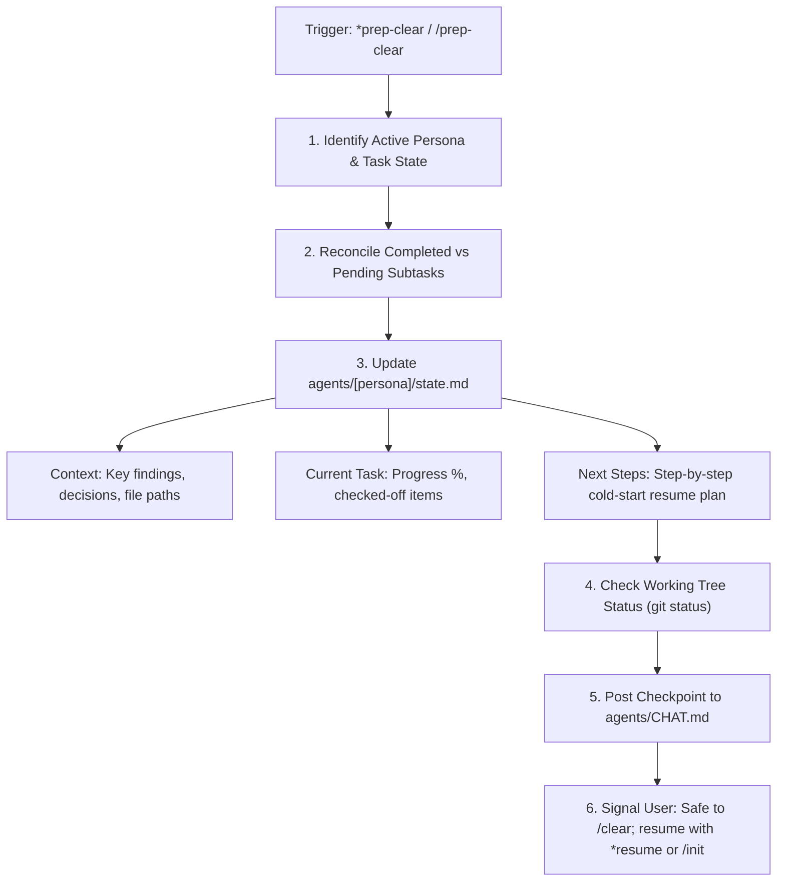

Prepares the active agent persona and workspace state before clearing, compacting, or resetting LLM context.

TLDR:
    Invoked via `*prep-clear`, `/prep-clear`, `*checkpoint`, or before `/clear` / `/compact`.
    Hard rule: `state.md` is the ONLY memory that survives context overflow, `/clear`, or session restarts.
    Reconciles in-flight work, writes Context, Current Task, and exact cold-start resume plan in `## Next Steps` of `agents/[persona]/state.md`.
    Logs checkpoint to `agents/CHAT.md`, confirms memory is saved, and signals user to safely execute `/clear`.

# Bob Protocol — Context Clear Preparation Skill (`prep-clear`)

## Overview

In LLM-driven development, context windows are ephemeral. Commands like `/clear`, `/compact`, session timeouts, or crashes completely wipe conversational memory.

The `prep-clear` skill provides a standardized, zero-loss checkpoint routine. It guarantees that all working memory, in-flight decisions, and resume instructions are safely persisted to disk before context is cleared, enabling seamless resumption via the `init` skill (`*resume` or `/init`).

---

## When to Run `prep-clear`

1. **Before Manual Context Clear**: When the user plans to run `/clear` or `/compact`.
2. **Context Window Exhaustion**: When context limits approach saturation (e.g., >70% token usage).
3. **Session Interruption**: When ending a work session or handing off work to another session/machine.
4. **Task Milestones**: After completing a major task or phase to establish a clean restore point.

---

## Checkpoint Lifecycle



---

## Step-by-Step Procedure

### 1. Identify Active Persona
Determine which persona is currently executing work:
- If a specialist is active (e.g. **Neo** mid-implementation, **Trin** mid-testing, **Morpheus** mid-architecture): that persona writes their own checkpoint.
- If between tasks or coordinating sprints: **Mouse** (`*sm`) or **Bob** (`*prompt`) handles the checkpoint.

### 2. Flush Working Memory to `agents/[persona]/state.md`
Update the active persona's single state file (`agents/[persona]/state.md`) across all three mandatory sections:

#### A. `## Context`
- Record all critical discoveries, architectural constraints, API contracts, or bug root causes identified during the session.
- Document exact file paths, modified symbols, and non-obvious dependencies so the resumed agent does not need to re-read the entire codebase.

#### B. `## Current Task`
- Set `Status`: `In Progress` or `Completed`.
- Update checklist:
  ```markdown
  ### Progress
  - [x] Subtask completed in this session
  - [x] Another completed item
  - [ ] Next subtask awaiting execution
  ```
- Document any active blockers or pending Oracle consultations.

#### C. `## Next Steps` (CRITICAL)
- **The Cold-Start Resume Plan**: Write this section under the assumption that the agent reading it will have ZERO memory of previous conversation turns.
- Provide concrete, immediate resume instructions:
  - Exact file to open
  - Exact command or make target to execute
  - Specific test or verification criterion

### 3. Check Workspace Status
Inspect git status:
- If there are unstaged or uncommitted changes, explicitly list them in `agents/[persona]/state.md` under `## Context` or `## Next Steps` so the next session knows what was left modified.

### 4. Post Checkpoint to `agents/CHAT.md`
Post a concise checkpoint message (under 512 chars) with the reason why:
```bash
bobp chat "Checkpoint saved in agents/<persona>/state.md. Next: <action>. Ready for context clear. Resume with *resume or /init." --persona <Persona> --cmd checkpoint
```

### 5. Confirm to User
Provide clear, actionable confirmation in the terminal/chat UI:
1. Confirm that `agents/[persona]/state.md` has been flushed and saved.
2. Confirm that `agents/CHAT.md` has recorded the checkpoint.
3. Explicitly inform the user:
   > **State secured.** You can now safely execute `/clear` or `/compact`.
   > To resume after clearing, run `/init` or `*resume`.

---

## Examples

### Example: Neo Preparing to Clear Context Mid-Refactor
```bash
# 1. Neo updates agents/neo/state.md with current progress and cold-start resume steps
# 2. Neo logs checkpoint:
bobp chat "Refactor phase 1 done; AST parser tests passing. Checkpointed state.md. Next: phase 2 visitor pattern. Ready for context clear." --persona Neo --cmd checkpoint
```

### Example: Trin Preparing to Clear Context Before Full UAT
```bash
# 1. Trin updates agents/trin/state.md with test matrix results
# 2. Trin logs checkpoint:
bobp chat "Unit tests 100% green. Checkpointed state.md. Next: execute integration UAT suite against mock API. Ready for context clear." --persona Trin --cmd checkpoint
```

---

## Invariants & Rules

1. **Never Clear Blindly**: Never prompt or tell the user to `/clear` without writing `state.md` first.
2. **Explicit Next Steps**: `## Next Steps` must never be left vague (e.g., "continue working"). It must specify the exact next action.
3. **Bounded Testing**: Do NOT run full test suites during `prep-clear` unless validating a fix right before checkpointing. Keep `prep-clear` fast and focused on memory persistence.
