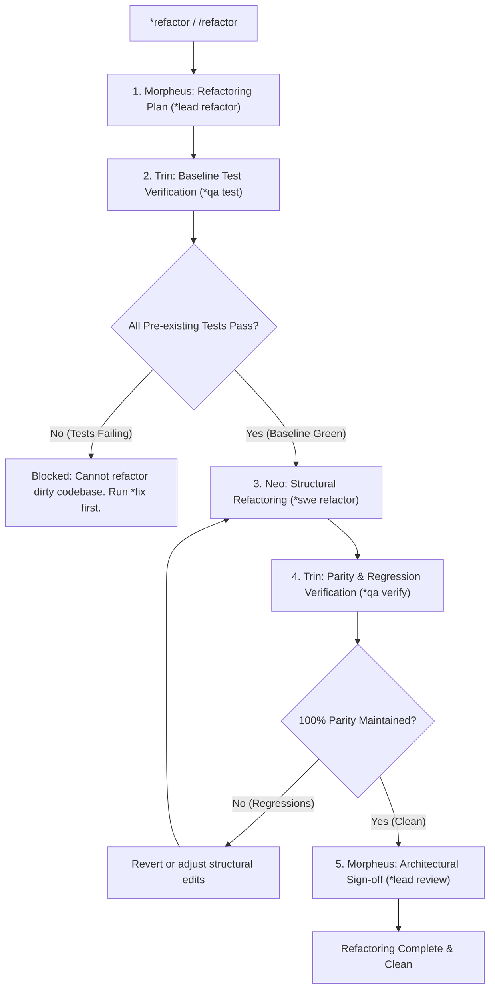

Technical debt and refactoring work-loop: restructures code with zero behavioral change under strict test protection.

TLDR:
    Literature: Martin Fowler (*Refactoring: Improving the Design of Existing Code*).
    Invariant: The Two Hats Rule. Zero functional change. The test suite MUST be 100% green BEFORE starting and 100% green AFTER finishing. No functional additions allowed.
    Chain: Morpheus (plan invariants & boundaries) → Trin (baseline test snapshot) → Neo (structural refactoring) → Trin (verify 100% test parity & zero regression) → Morpheus (architectural review).

# Technical Debt & Refactoring Work-Loop (`refactor`)

## Overview

The `refactor` work-loop cleans up accumulated technical debt, decouples monolithic modules, modernizes outdated patterns, and reduces cyclomatic complexity. Grounded in Martin Fowler’s refactoring discipline, it operates under the strict invariant that software behavior remains completely invariant throughout the transformation.

---

## Literature Grounding: Martin Fowler (*Refactoring*)

> *"Refactoring is a disciplined technique for restructuring an existing body of code, altering its internal structure without changing its external behavior... When you wear the refactoring hat, you do not add any features; you only restructure the code. You do not add tests; you only alter tests if an interface has changed."*  
> — Martin Fowler, *Refactoring: Improving the Design of Existing Code*

In this work-loop:
1. **Two Hats Discipline**: Refactoring is NEVER combined with adding new features or fixing unrelated bugs. If a bug is found during refactoring, log it or run a `*fix` loop separately.
2. **Baseline Green Precondition**: Before writing a single line of structural changes, Trin must prove that the existing test suite is 100% green. If tests are failing beforehand, refactoring is blocked.
3. **Behavior Invariance**: After the refactoring, every single preexisting test must pass without modification (unless a symbol was intentionally renamed).

---

## The `refactor` Lifecycle



---

## Step-by-Step Procedure

### Step 1: Morpheus — Refactoring Architecture & Invariants (`*lead refactor <target>`)
- Define the scope, boundaries, and target architecture for the refactoring.
- Identify the invariant behaviors that must NOT change.
- Deconstruct the refactoring into small, atomic structural operations (e.g. Extract Function, Move Class, Decouple Interface).
- **Handoff:**
  ```bash
  bobp chat "Refactoring plan established for <target>. @Trin *qa test (baseline verification)" --persona Morpheus --cmd "lead handoff" --to Trin
  ```

### Step 2: Trin — Baseline Verification (`*qa test`)
- Run the full project test suite via `bobp make test`.
- **Precondition Check**: If any tests fail, HALT immediately. Do not refactor on top of a broken build.
- Record the baseline test count and pass status.
- **Handoff:**
  ```bash
  bobp chat "Baseline verified green (N/N tests passing). @Neo *swe refactor <target>" --persona Trin --cmd "qa handoff" --to Neo
  ```

### Step 3: Neo — Structural Refactoring (`*swe refactor <target>`)
- Execute the refactoring steps outlined by Morpheus.
- **Rules for Neo**:
  1. Do NOT add new functional features.
  2. Do NOT alter public behavior or contracts.
  3. Clean up smells, improve naming, reduce duplication, and decouple components.
- Run local tests frequently during transformation.
- **Handoff:**
  ```bash
  bobp chat "Structural refactor complete for <target>. @Trin *qa verify <target>" --persona Neo --cmd "swe handoff" --to Trin
  ```

### Step 4: Trin — Parity & Regression Verification (`*qa verify <target>`)
- Run the complete test suite via `bobp make test`.
- Verify 100% test pass parity: all tests that passed before must pass now.
- Check linter and static typing if applicable.
- **Handoff on Pass:**
  ```bash
  bobp chat "Refactor verified: 100% behavioral parity, 0 regressions. @Morpheus *lead review <target>" --persona Trin --cmd "qa handoff" --to Morpheus
  ```

### Step 5: Morpheus — Architectural Sign-off (`*lead review <target>`)
- Review code diff to ensure cleanliness, pattern adherence, and that no unintended features leaked in.
- Sign off and update architectural documentation if structural boundaries changed.

---

## Anti-Loop Guard

If refactoring causes persistent test failures or broken contracts after 2 attempts:
1. Revert to git baseline.
2. Re-assess the refactoring plan with Morpheus.
3. Consult Oracle if unexpected inter-module coupling is detected.

---

## Loop Effectiveness Rubric (`LOOP_REFACTOR`)

Reviewed by Morpheus (at Step 5 Architectural Sign-off) or Smith (during `*judge refactor`).  
Verdict line in `agents/CHAT.md`: `rubric LOOP_REFACTOR: TWOHAT=L BASELN=L PARITY=L DESIGN=L ATOMIC=L`

| Code | Criterion | Weak (W) | Acceptable (A) | Strong (S) |
|---|---|---|---|---|
| `TWOHAT` | **Two-Hats Invariant** | New functionality, API changes, or opportunistic bugfixes blended into the refactoring diff. | 100% pure refactoring; external behavior, public contracts, and CLI interfaces remained strictly identical. | Explicitly isolated pure transformations; logged discovered bugs as separate `*fix` candidates rather than fixing in-place. |
| `BASELN` | **Baseline Verification** | Began refactoring with failing or unverified tests; assumed codebase was green without captured test run. | Trin ran full suite via `bobp make test` before edits; confirmed 100% green baseline and recorded test count in CHAT.md. | Verified baseline test coverage for target modules; augmented missing baseline tests prior to refactoring if coverage had gaps. |
| `PARITY` | **Behavioral & Test Parity** | Preexisting tests modified to make them pass after refactoring; deleted tests; reduced assertion count. | 100% of preexisting tests pass without test code modification (excluding intentional, approved symbol renames). | Full test suite runs green with zero changes to existing assertions; test run time equal or faster; linter and type-checker clean. |
| `DESIGN` | **Design Improvement** | Code rearranged cosmetically without reducing complexity; increased indirection with unnecessary wrappers. | Reduced duplication, improved naming clarity, decoupled monolithic functions/classes, and aligned with standard patterns. | Measurable reduction in cyclomatic complexity; eliminated code smells named in Fowler's taxonomy; improved module cohesion. |
| `ATOMIC` | **Micro-Step Cadence** | Giant big-bang rewrite touching dozens of files at once, making regression debugging impossible. | Executed in logical, bounded increments (e.g. Extract Function, Rename Symbol, Move Class) with frequent test checks. | Each micro-step verified with fast quiet tests; easily reversible diff sequence; zero disruption to active development. |
