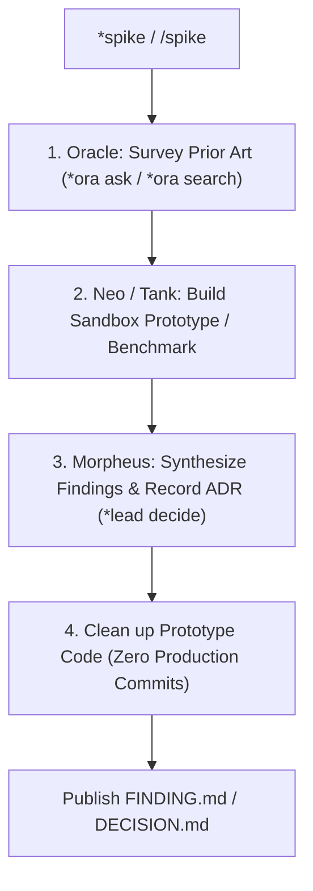

Research spike work-loop: timeboxed, throwaway technical exploration producing an architectural finding or decision.

TLDR:
    Literature: Ward Cunningham & Ron Jeffries (*Extreme Programming Installed*) & Ryan Singer (*Shape Up*).
    Invariant: Disposable Exploration. Commits ZERO production code. Timeboxed investigation delivering a FINDING.md or DECISION.md artifact to de-risk planning.
    Chain: Oracle (prior art & docs) → Neo / Tank (sandbox POC / benchmark) → Morpheus (synthesis & architecture decision).

# Research Spike Work-Loop (`spike`)

## Overview

The `spike` work-loop tackles high-risk technical unknowns, evaluates unfamiliar third-party libraries, benchmarks alternative algorithms, or probes feasibility before a team commits to a delivery estimate. Grounded in Extreme Programming spike solutions and *Shape Up* risk-reduction techniques, it trades a bounded burst of effort for architectural certainty.

---

## Literature Grounding: Ward Cunningham, Ron Jeffries & Ryan Singer

> *"A spike solution is a very simple program to explore the potential solutions. Build only enough code to test the concept, ignore everything else, and throw the code away once you've learned what you need."*  
> — Ward Cunningham & Ron Jeffries, *Extreme Programming Installed*

> *"A spike is a scoped, isolated experiment to solve a rabbit hole. We aren't building a feature; we are finding out if a feature is possible within our appetite."*  
> — Ryan Singer, *Shape Up*

In this work-loop:
1. **Timeboxed & Bound**: The spike is bounded to a specific technical question (e.g., *"Can SQLite handle 10,000 writes/sec in WAL mode on our target hardware?"*).
2. **Disposable Code**: Any prototype code is written in scratch/ or a throwaway test branch. It is **never** merged directly into production code.
3. **Artifact Output**: The tangible deliverable of a spike is a structured [`FINDING`](file:///home/drusifer/Projects/bob_protocol/agents/templates/_template_finding.md) or [`DECISION`](file:///home/drusifer/Projects/bob_protocol/agents/templates/_template_DECISION.md) artifact that informs downstream Planning Loops.

---

## The `spike` Lifecycle



---

## Step-by-Step Procedure

### Step 1: Oracle — Prior Art & Knowledge Survey (`*ora ask <topic>`)
- Check existing project documentation, `agents/oracle/lessons.md`, and architectural records.
- Identify known constraints, previous attempts, or external library documentation.
- **Handoff:**
  ```bash
  bobp chat "Prior art gathered for <topic>. @Neo *swe spike <topic> (or @Tank for infra)" --persona Oracle --cmd "ora handoff" --to Neo
  ```

### Step 2: Neo / Tank — Sandbox Prototyping & Benchmarking
- Build a minimal, isolated experiment in `scratch/` or an ephemeral script.
- Test the specific feasibility hypothesis or benchmark performance under load.
- Record concrete measurements, error traces, and edge cases.
- **Handoff:**
  ```bash
  bobp chat "Spike prototype complete. Data and findings ready. @Morpheus *lead decide <topic>" --persona Neo --cmd "swe handoff" --to Morpheus
  ```

### Step 3: Morpheus — Findings Synthesis & Decision (`*lead decide <topic>`)
- Evaluate prototype results against system requirements and architectural constraints.
- Formalize findings using the [`_template_finding.md`](file:///home/drusifer/Projects/bob_protocol/agents/templates/_template_finding.md) or [`_template_DECISION.md`](file:///home/drusifer/Projects/bob_protocol/agents/templates/_template_DECISION.md) format.
- Determine whether the approach is viable for production adoption or if an alternative must be pursued.

### Step 4: Cleanup
- Ensure no throwaway prototype code or temporary test scripts leak into the production codebase.
- Save the finding in `docs/` or `agents/oracle/` as permanent project reference.
- Close the spike loop.

---

## Anti-Loop Guard

If a spike fails to prove feasibility within its timebox:
1. Do not endlessly extend the spike.
2. Record an explicit "Infeasible" or "High Risk" finding in `FINDING.md`.
3. Escalate to the Story or Epic planning loop to consider alternative technical paths.

---

## Loop Effectiveness Rubric (`LOOP_SPIKE`)

Reviewed by Morpheus or Oracle (at Step 3/4 Findings Synthesis) or during `*judge spike`.  
Verdict line in `agents/CHAT.md`: `rubric LOOP_SPIKE: TIMEBX=L DISPOS=L EMPIR=L ARTIFACT=L CLARITY=L`

| Code | Criterion | Weak (W) | Acceptable (A) | Strong (S) |
|---|---|---|---|---|
| `TIMEBX` | **Timebox Bounding** | Open-ended wandering research without explicit question or stopping criteria; exceeded time budget exploring tangents. | Bounded to a specific feasibility, performance, or API integration question with a clear time limit. | Formulated as a crisp, falsifiable hypothesis (e.g. "Can library X achieve Y throughput in Z ms?") with explicit boundary stops. |
| `DISPOS` | **Disposable Isolation** | Prototype code committed directly to production modules or main codebase branches without isolation. | Prototype built strictly in `scratch/`, disposable test scripts, or a throwaway sandbox branch; zero production commits. | Complete isolation verified; all scratch artifacts cleanly organized or purged; zero residual dependencies added to manifests. |
| `EMPIR` | **Empirical Evidence** | Recommendation based on marketing claims, documentation assumptions, or intuition without executing code. | Executed real code; recorded quantitative benchmarks, error traces, resource consumption, or compatibility results. | Rigorous benchmark matrix across multiple scenarios; documented edge cases and failure modes under stress or boundary inputs. |
| `ARTIFACT` | **Deliverable Quality** | Results lost in chat history or unstructured monologue; missing context, alternatives, or trade-off evaluation. | Structured artifact created in `docs/` or `agents/oracle/` following `_template_finding.md` or `_template_DECISION.md`. | Exemplary MADR or finding artifact; articulates trade-offs, negative consequences, rejected alternatives, and implementation costs. |
| `CLARITY` | **Actionable Direction** | Ambiguous "it depends" conclusion without recommendation; leaves downstream planners with same uncertainty. | Definitive recommendation (proceed, pivot, or abandon) with clear justification for Story/Sprint planning. | Outlines exact architectural constraints, dependency requirements, and risks for downstream implementation loops (`*impl`). |
