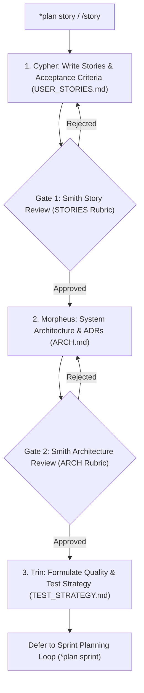

Story and architecture specification planning loop: slices epics into actionable user stories, ADRs, and acceptance criteria.

TLDR:
    Literature: Jeff Patton (*User Story Mapping*) & Mike Cohn (*User Stories Applied*).
    Focus: Slicing strategic epics into independent, valuable, testable user stories with explicit acceptance criteria, architectural ADRs, and test strategies.
    Chain: Cypher (User Stories) → Smith (Gate 1: Stories Review) → Morpheus (Architecture & ADRs) → Smith (Gate 2: Architecture Review) → Trin (Quality & UAT Strategy).
    Defers to: Sprint Planning & Cadence Loop (`*plan sprint`).

# Story & Architecture Specification Loop (`story`)

## Overview

The `story` planning loop translates high-level epic shapes into concrete, reviewable engineering specifications. Grounded in Jeff Patton’s *User Story Mapping* and Mike Cohn’s *User Stories Applied*, it produces thin, vertically sliced stories accompanied by rigorous acceptance criteria, architectural decision records (MADR), and quality strategies.

---

## Literature Grounding: Jeff Patton & Mike Cohn

> *"Stories get their name not from how they are written, but from how they are used. We tell stories together to build shared understanding before we build software... A story is an invitation to a conversation, documented with clear confirmation criteria."*  
> — Jeff Patton, *User Story Mapping*

In this loop:
1. **Vertical Slicing**: Stories cut through all layers (UI/CLI $\rightarrow$ logic $\rightarrow$ data) rather than horizontal technical tasks.
2. **Review Gates (Brookhart Standards)**: Smith reviews both stories (Gate 1) and architecture (Gate 2) using standardized rubrics to prevent underspecified work from reaching developers.
3. **Standing Strategy**: Trin establishes the quality strategy and test boundaries in [`_template_TEST_STRATEGY.md`](file:///home/drusifer/Projects/bob_protocol/agents/templates/_template_TEST_STRATEGY.md) before tasks are broken out.

---

## The `story` Lifecycle



---

## Step-by-Step Procedure

### Step 1: Cypher — User Stories + Acceptance Criteria
- Author stories using [`agents/templates/_template_USER_STORIES.md`](file:///home/drusifer/Projects/bob_protocol/agents/templates/_template_USER_STORIES.md).
- Follow the standard template: *As a [role], I want [capability] so that [benefit]*.
- Detail explicit, testable Given-When-Then acceptance criteria.
- **Handoff:**
  ```bash
  bobp chat "Stories authored for feature. @Smith *user review stories" --persona Cypher --cmd "pm handoff" --to Smith
  ```

### Gate 1: Smith — Story Review Gate
- Evaluate stories against HCI principles, clarity, and user outcomes.
- Apply the STORIES rubric from [`agents/templates/ARTIFACTS.md`](file:///home/drusifer/Projects/bob_protocol/agents/templates/ARTIFACTS.md).
- Require explicit `*user approve` to proceed. If rejected, Cypher revises.

### Step 2: Morpheus — Architecture & Decisions
- Draft system design using [`agents/templates/_template_ARCH.md`](file:///home/drusifer/Projects/bob_protocol/agents/templates/_template_ARCH.md).
- Capture non-trivial technical trade-offs as Architecture Decision Records (ADRs).
- Ensure alignment with the ubiquitous language in `DOMAIN.md`.
- **Handoff:**
  ```bash
  bobp chat "Architecture & ADRs complete. @Smith *user feedback arch" --persona Morpheus --cmd "lead handoff" --to Smith
  ```

### Gate 2: Smith — Architecture Review Gate
- Apply the ARCH review rubric from `ARTIFACTS.md`.
- Confirm the architectural structure supports the intended user experience without friction.
- Require explicit `*user approve` to proceed.

### Step 3: Trin — Quality & Test Strategy
- Establish the standing quality strategy in [`agents/templates/_template_TEST_STRATEGY.md`](file:///home/drusifer/Projects/bob_protocol/agents/templates/_template_TEST_STRATEGY.md).
- Define unit, integration, and UAT boundaries, test environments, and quality bars.

### Step 4: Deferral to Sprint Planning
- Story specifications are complete and verified. Hand off to Mouse to schedule into a **Sprint** (`*plan sprint`).

---

## Loop Effectiveness Rubric (`LOOP_STORY`)

Reviewed by Smith (at Gate 1 & Gate 2) or Morpheus or during `*judge story`.  
Verdict line in `agents/CHAT.md`: `rubric LOOP_STORY: SLICE=L INVEST=L GHERK=L ARCHAL=L STRAT=L`

| Code | Criterion | Weak (W) | Acceptable (A) | Strong (S) |
|---|---|---|---|---|
| `SLICE` | **Vertical User Slicing** | Horizontal component stories ("write schema", "build UI mockup", "write backend") that deliver zero standalone user value. | Vertical slices traversing interface to storage that deliver observable capability to a user or developer. | Thin, elegant end-to-end slices; each slice demonstrable independently; prioritized by narrative workflow in story map. |
| `INVEST` | **INVEST Independence & Size** | Monolithic stories; tightly coupled dependencies requiring simultaneous delivery; untestable vague descriptions. | Independent stories sized to fit cleanly within 1-3 tasks; clear value proposition; easily estimated and testable. | Completely decoupled stories allowing arbitrary delivery order; minimal dependencies; sized for rapid work-loop execution. |
| `GHERK` | **Testable Acceptance Criteria** | Criteria contain subjective adjectives ("should work properly", "fast", "clean"); lacks verifiable assertions. | Unambiguous Given-When-Then scenarios with explicit inputs, triggers, and expected observable outcomes. | Comprehensive scenarios covering edge conditions, error states, and boundary values; directly convertible into automated tests. |
| `ARCHAL` | **Architectural Alignment & ADRs** | Architecture missing or disconnected from stories; undocumented architectural shortcuts or unvetted dependencies. | `ARCH.md` articulates module structure, data flows, and trade-offs; includes ADRs for non-trivial decisions; passes ARCH rubric. | Clean separation of concerns; explicit interface contracts; ADRs detail positive/negative consequences and alternatives. |
| `STRAT` | **Test Strategy Readiness** | No test strategy; leaves test levels and verification approach undefined until development starts. | `TEST_STRATEGY.md` defines unit, integration, and UAT boundaries, test tooling, and pass criteria. | Comprehensive testing pyramid tailored to the story scope; identifies mocks vs live dependencies; passes STRATEGY rubric. |
