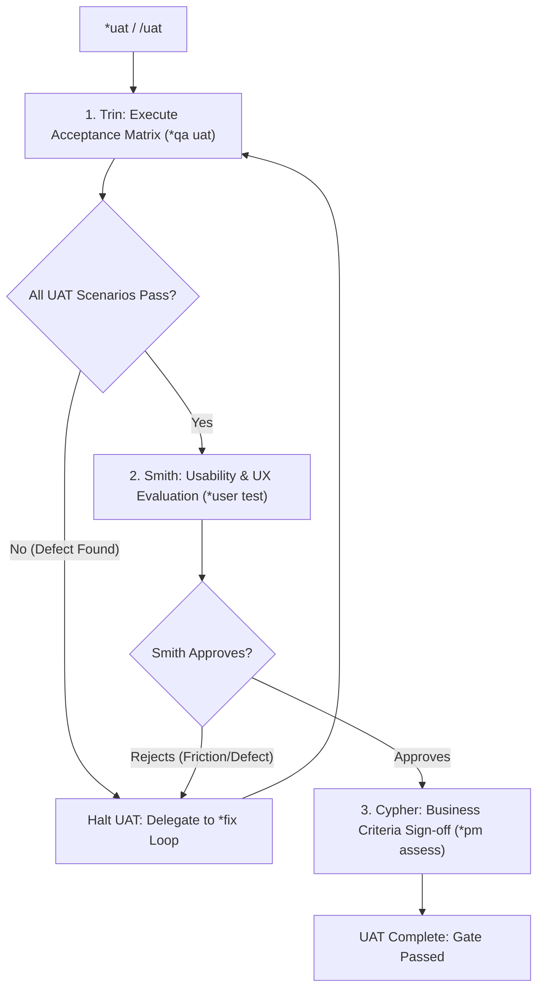

User acceptance testing (UAT) and usability verification work-loop: validates whole-system customer experience and acceptance criteria.

TLDR:
    Literature: Lisa Crispin & Janet Gregory (*Agile Testing: A Practical Guide for Testers and Agile Teams*).
    Invariant: Real-World Business Critique. Tests running systems and user journeys against business goals, not just mock assertions.
    Chain: Trin (executes UAT scenario matrix) → Smith (evaluates UX, ergonomics & friction) → Cypher (acceptance criteria sign-off).
    Defect handling: Any failure halts UAT and immediately spawns a targeted `*fix` loop.

# User Acceptance & Usability Work-Loop (`uat`)

## Overview

The `uat` work-loop evaluates integrated software from the end-user, developer-consumer, and product owner perspective. Grounded in Lisa Crispin and Janet Gregory's Agile Testing Quadrants (specifically Quadrants 3 and 4: business-facing tests that critique the product), it ensures that software not only works technically, but delivers delightful, correct, and frictionless utility.

---

## Literature Grounding: Lisa Crispin & Janet Gregory (*Agile Testing*)

> *"Quadrant 3 tests critique the product from a business user's perspective. These are user acceptance tests, exploratory testing, and usability evaluations... They ask: 'Did we build the right thing, and does it actually solve the user's problem in a realistic workflow?'"*  
> — Lisa Crispin & Janet Gregory, *Agile Testing*

In this work-loop:
1. **Scenario Matrix**: Trin runs end-to-end acceptance scenarios derived from the sprint’s [`UAT_PLAN.md`](file:///home/drusifer/Projects/bob_protocol/agents/templates/_template_UAT_PLAN.md).
2. **HCI & Ergonomics**: Smith audits the actual user experience (CLI output formatting, interactive prompts, error readability, task friction) against Brookhart usability rubrics.
3. **Business Sign-Off**: Cypher confirms all user stories and acceptance criteria are fulfilled.
4. **Defect Delegation**: If a scenario fails or usability is blocked, `uat` pauses and delegates directly to a `*fix` loop.

---

## The `uat` Lifecycle



---

## Step-by-Step Procedure

### Step 1: Trin — Acceptance Scenario Execution (`*qa uat <scope>`)
- Load [`agents/templates/_template_UAT_PLAN.md`](file:///home/drusifer/Projects/bob_protocol/agents/templates/_template_UAT_PLAN.md) or the active sprint UAT plan.
- Execute realistic end-to-end user workflows against the running build.
- Validate critical happy paths, boundary values, error messages, and state transitions.
- **Defect Rule**: If an acceptance test fails, halt UAT immediately. Do not attempt in-place code edits; hand off to Neo via `*fix` with reproduction steps.
- **Handoff on Pass:**
  ```bash
  bobp chat "UAT scenario matrix verified green. @Smith *user test <scope>" --persona Trin --cmd "qa handoff" --to Smith
  ```

### Step 2: Smith — Usability & UX Audit (`*user test <scope>`)
- Evaluate the system’s interaction ergonomics:
  - Command discoverability and `--help` quality.
  - Output formatting (consistent tabular/JSON layouts, readable errors, clean progress indicators).
  - Friction analysis: how many steps does the user need to accomplish their goal?
- Apply the UAT Brookhart review rubric.
- Post explicit approval: `*user approve` or identify required polish items.
- **Handoff:**
  ```bash
  bobp chat "*user approve. UX and functional usability validated. @Cypher *pm assess <scope>" --persona Smith --cmd "user handoff" --to Cypher
  ```

### Step 3: Cypher — Business Value Sign-Off (`*pm assess <scope>`)
- Compare final behavior against the original acceptance criteria in `USER_STORIES.md`.
- Validate that the scope matches the sprint commitment without scope drift.
- Mark the feature or phase as accepted.

---

## Anti-Loop Guard

If UAT acceptance fails more than twice for the same scenario:
1. Halt the UAT work-loop.
2. Convene a triaging check in `agents/CHAT.md` between Cypher (PM), Morpheus (Architect), and Smith (UX).
3. Determine whether the acceptance criterion was underspecified or if a fundamental design flaw exists.

---

## Loop Effectiveness Rubric (`LOOP_UAT`)

Reviewed by Smith (at Step 2 UX audit) or Cypher (at Step 3 Sign-Off) or during `*judge uat`.  
Verdict line in `agents/CHAT.md`: `rubric LOOP_UAT: REALIS=L MATRIX=L ERGON=L DEFECT=L GOAL=L`

| Code | Criterion | Weak (W) | Acceptable (A) | Strong (S) |
|---|---|---|---|---|
| `REALIS` | **Real System Execution** | Evaluated solely against unit test mocks or code inspections without executing the compiled/running software. | Evaluated against live running processes, CLI binary invocations, or running servers in an active environment. | Real environment testing with representative data sets, edge configurations, and authentic user interaction patterns. |
| `MATRIX` | **Scenario Matrix Coverage** | Scenarios skipped or evaluated haphazardly without reference to `UAT_PLAN.md` or `USER_STORIES.md`. | Every acceptance scenario declared in sprint plan tested; pass/fail results recorded for happy path and boundary cases. | Comprehensive matrix validation including concurrent usage, recovery from invalid inputs, and state transition resilience. |
| `ERGON` | **HCI & Ergonomic Audit** | Rubber-stamped without evaluating human ergonomics; ignored cryptic error messages, visual clutter, or unnecessary input steps. | Audited CLI/UI outputs for clarity, formatting consistency, help text availability, and straightforward error prompts. | Exhaustive heuristic evaluation; identified cognitive friction points, suggested concrete UX polish items, and verified error recovery paths. |
| `DEFECT` | **Defect Handling** | Ignored failing scenarios; attempted to patch code directly within UAT step; or abandoned testing upon first failure. | UAT halted upon defect; clear reproduction steps filed; delegated immediately to Neo via `*fix` loop. | Defect filed with exact input command, expected output, actual output, and ergonomic impact; re-verified systematically after fix. |
| `GOAL` | **Business Value Alignment** | Verified technical checkmarks but ignored whether the original user story benefit and customer value were achieved. | Confirmed delivered capabilities fulfill user story intent, acceptance criteria, and non-functional requirements. | Evaluated business impact against the epic roadmap; confirmed zero feature creep or missing workflow links. |
