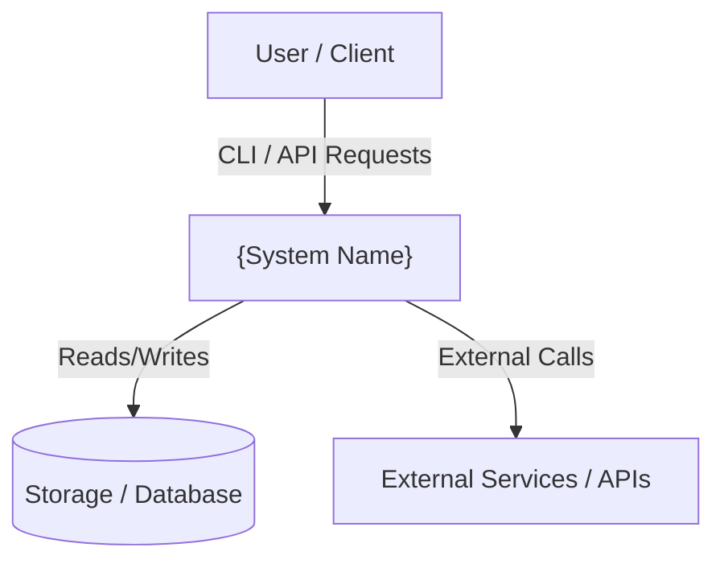
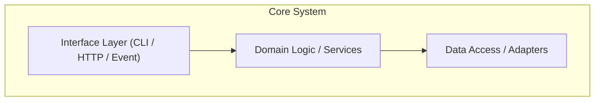
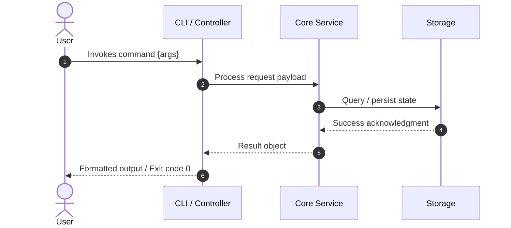

<!--
Architecture document template. Owned by Morpheus — see agents/morpheus/SKILL.md and the sprint skill.
Can be instantiated as `docs/ARCH.md` (standing project architecture) or appended to the sprint
stories document during Sprint Planning Step 2.
Delete this comment AND the review rubric at the end (everything from RUBRIC-START to
RUBRIC-END): the rubric belongs to the template, not to the document.
Smith reviews this at Gate 2 using the ARCH rubric.
-->
# Architecture Document: {System or Feature Name}

*   **Status**: Draft — awaiting Smith Gate 2
*   **Author**: Morpheus
*   **Last Updated**: {YYYY-MM-DD}
*   **Scope**: {Project-wide ARCH.md | Sprint {N} Architecture}

---

## 1. Executive Summary & System Overview

{High-level summary: 2-4 sentences describing the purpose of the architecture, key problems solved, and primary business or technical drivers.}

## 2. System Context & Boundaries

{Describe the system boundary: who interacts with it (users, external services, upstream/downstream pipelines), network boundaries, and trust domains.}

## 3. Component & Container Architecture

{Decompose the system into cohesive components or containers. Describe the single responsibility of each block.}

### Component Inventory
| Component | Responsibility | Inputs | Outputs |
|---|---|---|---|
| `{Component A}` | {Single clear responsibility} | {Call / Event / Data} | {Response / State change} |
| `{Component B}` | {Single clear responsibility} | {Call / Event / Data} | {Response / State change} |

## 4. Runtime Interaction & Critical Flows

{Illustrate critical execution paths (happy path and primary workflows) with sequence diagrams showing caller, callee, and payloads.}

## 5. Interface & Contract Specifications

{Define observable interfaces: CLI commands, flags, exit codes, API endpoints, schemas, or key data structures.}

* **Command / Endpoint:** `{command name or route}`
* **Parameters / Flags:**
  * `--{flag}`: {Type, default, validation constraints}
* **Output Format:** {JSON schema, stdout table, exit codes on success/failure}

## 6. Cross-Cutting Concepts & Resilience

### Failure Modes & Error Handling
| Failure Mode | Trigger / Condition | System Behavior | User / Client Impact | Blast Radius |
|---|---|---|---|---|
| `{Dependency Timeout}` | {Network partition or slow remote} | {Timeout after Ns, retry with backoff, abort} | {Clear error message, exit code X} | {Isolated to calling command} |
| `{Invalid Input}` | {Malformed file or invalid flag} | {Validation fails before execution} | {Helpful fix suggestion, state unmodified} | {None (zero state change)} |

### Security & Privacy
* **Authentication / Authorization:** {How identity/permissions are validated} / None.
* **Sensitive Data:** {Handling of credentials, tokens, or PII} / None.

## 7. Technical Stack & SDLC / Build Impact

* **Languages & Runtime:** `{e.g. Python 3.13, Node 20}`
* **Core Libraries & Tools:** `{e.g. pytest, pydantic}`
* **Build-Environment Check (CRITICAL):**
  * Does this design add a new language, package manager, runtime version, or external tool? **{Yes | No}**
  * *If Yes:* Explicitly flag for Mouse to schedule a **Tank Phase 0** (`*devops bootstrap` or `*devops sdlc`) before implementation.
  * All dependencies follow `docs/SDLC.md` change classes.

## 8. Architectural Decisions (ADRs) & Technical Debt

### Decision Records
* `{ADR-001}`: {Short title and decision outcome — link to record}

### Acknowledged Technical Debt & Trade-offs
* `{Debt Item}`: {What compromise was made, why it was accepted now, and when it will be repaid}

<!-- RUBRIC-START — for reviewers. Delete everything from here to RUBRIC-END when you turn this
     template into a real document. -->
## Appendix: Review rubric — ARCH

Self-checked by Morpheus before handoff; reviewed by Smith at Gate 2.
Verdict line: `rubric ARCH: BOUND=_ FLOW=_ FAIL=_ USER=_ DECS=_ FEAS=_` (W, A or S).
Any W rejects, naming the criterion and the fix. See `agents/templates/ARTIFACTS.md`.

| Code | Criterion | Weak (W) | Acceptable (A) | Strong (S) |
|---|---|---|---|---|
| `BOUND` | Does it clearly delimit system boundaries and responsibilities? | Boundaries are blurred or contradictory; components have overlapping duties; external interactions are handwaved ("magic happens here"). | System boundary is explicit; each component has a single responsibility; external systems and communication protocols are identified. | Diagrams follow C4 conventions; each boundary documents its interface contract and trust/security assumptions. |
| `FLOW` | Can an engineer trace data and execution through critical paths? | Data flow is described only in narrative prose without sequencing, or diagrams lack direction/order, leaving call sequences ambiguous. | Critical paths have explicit sequence diagrams or step-by-step flows specifying caller, callee, and payload purpose. | Sequence diagrams specify data payload shapes, sync vs. async distinction, and latency/concurrency expectations. |
| `FAIL` | Does it define behavior when dependencies fail or input is invalid? | Assumes happy-path execution; lacks timeout, retry, fallback, or error-propagation strategies; failure leaves state undefined. | Identifies primary failure modes for external calls and internal processing; specifies error reporting and blast-radius containment. | Defines explicit circuit breakers/fallbacks, transaction/rollback boundaries, and user-facing error mappings for each failure. |
| `USER` | Does it preserve HCI standards and protect the user mental model? | Exposes internal database keys, raw stack traces, unhandled exceptions, or conflicting CLI flags/API schemas to the user surface. | Commands, API endpoints, flags, and outputs match user mental models, use consistent naming, and follow project UX standards. | Flags breaking changes with migration paths, provides copy-pasteable CLI/API examples, and adheres to Nielsen's heuristics. |
| `DECS` | Are technical choices defended with context and tradeoffs? | Announces a technology or pattern without explaining why ("we will use X"); ignores obvious alternatives or drawbacks. | States driving requirements, at least one alternative considered, and why the chosen option was selected. | Links to or includes MADR-style decision records explicitly noting accepted technical debt, positive gains, and negative consequences. |
| `FEAS` | Does it account for build-environment and operational feasibility? | Introduces new languages, packages, or services without checking `docs/SDLC.md`, or requires tools that cannot run in `make`. | All dependencies adhere to SDLC change classes; flags any new runtime, language, or package manager as a Tank Phase 0. | Specifies exact package versions, verification make targets, and migration/rollback steps for deployment. |
<!-- RUBRIC-END -->
