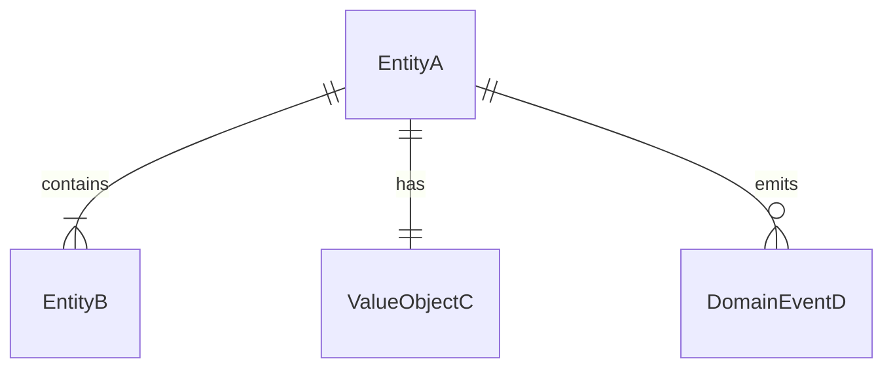
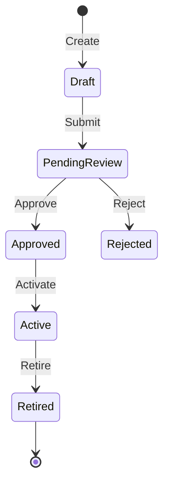

<!--
Domain Model & Ubiquitous Language specification template.
Owned by Cypher (Product Manager) and Morpheus (Tech Lead) — see agents/cypher/SKILL.md and agents/morpheus/SKILL.md.
Instantiated as `docs/DOMAIN.md` (or `docs/domain/<subdomain>.md` in multi-context projects).
Delete this comment AND the review rubric at the end (everything from RUBRIC-START to
RUBRIC-END): the rubric belongs to the template, not to the document.
Reviewed by Smith and Morpheus using the DOMAIN rubric.
-->
# Domain Model: {Domain or Subdomain Name}

*   **Bounded Context**: `{ContextName, e.g. Billing, Catalog, Messaging}`
*   **Status**: {Draft | Active | Deprecated}
*   **Domain Owners**: Cypher (*pm), Morpheus (*lead)
*   **Last Updated**: {YYYY-MM-DD}

---

## 1. Executive Summary & Strategic Context

{Provide a 2-4 sentence summary of what business capabilities this domain handles. Explain its role in the overall system and its relationship to upstream/downstream contexts.}

* **In-Scope Capabilities:** {Core capabilities and responsibilities that strictly belong here}
* **Out-of-Scope:** {What explicitly belongs to other contexts, e.g. "User authentication is handled by IdentityContext"}
* **Upstream Contexts:** `{Contexts this domain depends on}`
* **Downstream Consumers:** `{Contexts or interfaces that consume this domain}`

---

## 2. Ubiquitous Language (Glossary)

The authoritative dictionary for this domain. Every term here represents an agreed-upon business concept and **must map identically to code symbols** (classes, methods, enums). Technical slang (e.g. "Record", "Manager", "DTO") is forbidden in domain concepts.

| Business Term | Kind | Definition & Business Rules | Code Mapping (Class / Method) |
|---|---|---|---|
| **{Term A}** | Entity / Aggregate Root | {Authoritative business definition and key rules} | `{ClassSymbol}` |
| **{Term B}** | Value Object | {Immutable concept defined purely by its attributes} | `{ValueClass / Dataclass}` |
| **{Term C}** | Command | {Intent to perform an action that alters domain state} | `{CommandHandler / Method}` |
| **{Term D}** | Domain Event | {Significant occurrence in the domain that domain experts care about} | `{EventClass}` |

*(Kinds: Entity, Value Object, Command, Domain Event, Domain Service, Policy)*

### Anti-Patterns (Forbidden & Deprecated Terminology)
Terms that must NOT be used in discussions, documentation, or code:

| Forbidden / Deprecated Term | Preferred Ubiquitous Term | Rationale |
|---|---|---|
| `{e.g. UserRecord}` | `{User}` | {"Record" leaks database persistence detail into business logic.} |
| `{e.g. ProcessData()}` | `{ValidateAndApplyDiscount()}` | {Vague technical phrasing hides the specific business rule.} |

---

## 3. Tactical Domain Model & Entity Relationships

{Visual model showing entities, value objects, and relationships within this context.}

### Entities vs. Value Objects Summary
* **Entities (Identity-based):**
  * `{EntityName}`: Identity defined by `{ID property}`. Mutable lifecycle.
* **Value Objects (Attribute-based):**
  * `{ValueObjectName}`: Defined entirely by its attributes. Immutable; equality by value.

---

## 4. Aggregates & Business Invariants

Aggregates define transactional consistency boundaries. Changes within an aggregate must satisfy all invariants before the transaction commits.

### Aggregate Root: `{AggregateRootName}`

* **Root Entity:** `{RootEntity}`
* **Boundary Members:** `{Contained Entities, Value Objects}`
* **Business Invariants (Must ALWAYS Be True):**
  1. *Invariant 1:* {e.g. An Order must contain at least one OrderLine before transition to Placed.}
  2. *Invariant 2:* {e.g. Total order amount cannot be negative after discounts are applied.}
  3. *Invariant 3:* {e.g. Line items cannot be modified once status is Shipped.}

---

## 5. Lifecycle & State Machine Transitions

{Explicitly document valid state progressions. Any transition not shown here must be rejected by the domain logic.}

### State Transition Matrix
| Current State | Triggering Command / Event | Next State | Guard Condition / Invariant |
|---|---|---|---|
| `{Draft}` | `{Submit}` | `{PendingReview}` | {All required fields valid} |
| `{PendingReview}` | `{Approve}` | `{Approved}` | {Authorized approver only} |
| `{PendingReview}` | `{Reject}` | `{Rejected}` | {Rejection reason provided} |

---

## 6. Domain Events & Side-Effects

{Domain events emitted when significant business occurrences take place.}

| Event Name | Trigger Condition | Key Payload Properties | Primary Consumers / Subscribers |
|---|---|---|---|
| `{EntityCreated}` | {When Entity.Create() succeeds} | `{entity_id, owner_id, timestamp}` | `{AuditService, NotificationService}` |
| `{StateChanged}` | {When state transition completes} | `{entity_id, old_state, new_state, actor}` | `{AnalyticsContext, DownstreamSync}` |

<!-- RUBRIC-START — for reviewers. Delete everything from here to RUBRIC-END when you turn this
     template into a real document. -->
## Appendix: Review rubric — DOMAIN

Self-checked by authors (Cypher & Morpheus) upon drafting; reviewed by Smith and Morpheus during sprint planning.
Verdict line: `rubric DOMAIN: LANG=_ BOUND=_ INVAR=_ STATE=_ EVENT=_` (W, A or S).
Any W rejects, naming the criterion and the fix. See `agents/templates/ARTIFACTS.md`.

| Code | Criterion | Weak (W) | Acceptable (A) | Strong (S) |
|---|---|---|---|---|
| `LANG` | Does the ubiquitous language define terms without technical jargon and map 1:1 to code? | Uses persistence/technical slang (e.g. "Record", "Manager", "DTO") in business terms, or terms lack explicit code symbol mappings. | Every term has a clear non-technical definition, explicit category (Entity, Value Object, Command, Event), and maps to a code symbol. | Includes an anti-patterns table of forbidden/deprecated terms with rationale, ensuring cross-team consistency. |
| `BOUND` | Are the boundaries and responsibilities of this domain clearly defined? | Boundaries are ambiguous; includes features or concepts belonging to other contexts without defining translation or ownership. | Explicitly documents what is in-scope vs. out-of-scope, and names upstream/downstream integrations. | Includes a Context Map showing integration patterns (Shared Kernel, Customer-Supplier, Anti-Corruption Layer) between contexts. |
| `INVAR` | Are aggregate roots and consistency boundaries defined with enforceable rules? | Aggregates are unbounded or missing; business rules are stated as vague aspirations rather than enforceable invariants. | Identifies aggregate roots, their contained entities/value objects, and invariants that must always hold true across transactions. | Invariants specify validation rules and error conditions, clearly separating aggregate invariants from external business workflows. |
| `STATE` | Does the model define valid lifecycle states and transitions for key entities? | Entity states are undefined, or transitions allow invalid sequences (e.g. paying for an already cancelled order). | Defines all valid states and allowable transitions (via text or state machine diagram), specifying the trigger for each transition. | Includes a complete Mermaid `stateDiagram` with terminal states, side-effects, and explicit rejection conditions for invalid transitions. |
| `EVENT` | Are domain events and their payloads documented for business occurrences? | Side-effects across components rely on tight coupling or hidden calls without defining domain events. | Identifies key domain events, their triggers, payload data properties, and downstream subscribers. | Event payloads are minimal, decoupled from database representations, and specify whether communication is sync or async. |
<!-- RUBRIC-END -->
